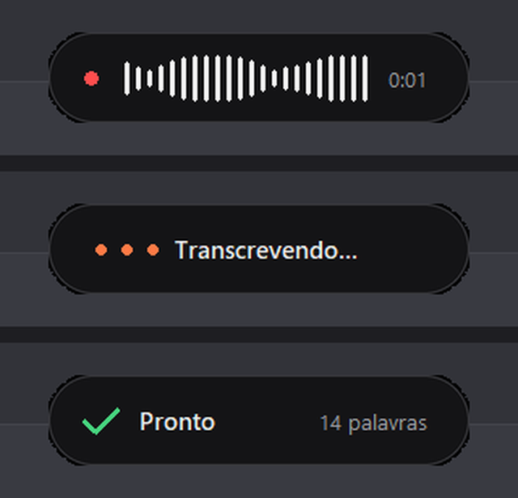

<div align="center">


# Ditado BR

**Segure uma tecla, fale em português e o texto aparece onde o cursor estiver.**
WhatsApp, Word, e-mail, Claude Code, ChatGPT, qualquer programa.

100% offline · grátis · sem conta · sem limite de uso



</div>

## Como usa

1. **Segure o Ctrl direito** e fale.
2. **Solte.** Em 1 a 2 segundos o texto aparece, já com pontuação e acentos.

Só isso. Uma janelinha discreta mostra a sua voz enquanto você fala e some quando termina. Ela nunca rouba o foco do programa em que você está.

## Por que usar

- **Sua voz não sai do PC.** A transcrição roda na sua máquina com o [Whisper](https://github.com/openai/whisper), sem nuvem e sem assinatura.
- **Escreve nomes difíceis certo.** No dicionário você ensina os termos do seu trabalho (`Claude Code`, nomes de clientes, gírias) e corrige o que ele ouvir errado (`cloud code => Claude Code`).
- **Rápido de verdade.** Com placa de vídeo NVIDIA, 4 segundos de fala viram texto em ~1,7 s com o modelo mais preciso (testado numa GTX 1650 de 4 GB). Sem placa, usa um modelo mais leve no processador.
- **Não apaga o que você copiou.** Depois de colar, ele devolve o conteúdo antigo da área de transferência.

## Instalação (Windows)

1. Instale o [Python 3.10 ou mais novo](https://www.python.org/downloads/) marcando **"Add python.exe to PATH"**.
2. [Baixe este repositório](https://github.com/sparks-gamesstudio/ditado-br/archive/refs/heads/main.zip) e descompacte.
3. Dê dois cliques em **`instalar.bat`**.

O instalador cria um ambiente isolado (não mexe no resto do seu Python), detecta se você tem placa NVIDIA e cria atalhos no Menu Iniciar e na Área de Trabalho. Na primeira vez que abrir, o Ditado baixa o modelo de voz (1,6 GB com placa de vídeo, 500 MB sem).

## Configurações

Clique com o botão direito no ícone perto do relógio:

| Opção | O que faz |
|---|---|
| **Tecla** | Ctrl direito, AltGr, F8, F9, Caps Lock, Scroll Lock ou Pause |
| **Modo** | *Segurar para falar* ou *Apertar para começar e parar* (bom para textos longos) |
| **Qualidade** | *Automática* escolhe sozinha. *Rápida* é a melhor opção se a sua placa vive ocupada com jogos ou com o Wallpaper Engine |
| **Microfone** | escolha qual usar |
| **Editar dicionário** | termos e correções (abre no Bloco de Notas) |
| **Ver histórico** | tudo o que você ditou, com data e hora |
| **Iniciar com o Windows** | abre sozinho quando o PC liga |

## Para quem gosta de código

```bash
git clone https://github.com/sparks-gamesstudio/ditado-br.git
cd ditado-br
python -m venv .venv && .venv\Scripts\activate
pip install -r requirements.txt
pip install -r requirements-nvidia.txt   # opcional, só com placa NVIDIA
python -m ditado
```

| Arquivo | O que faz |
|---|---|
| `ditado/app.py` | tecla de atalho, ícone na bandeja e fila de transcrição |
| `ditado/audio.py` | gravação a 16 kHz e nível de volume ao vivo |
| `ditado/transcrever.py` | faster-whisper, com placa de vídeo primeiro e processador como reserva, além do dicionário |
| `ditado/janela.py` | a pílula flutuante que não rouba o foco |
| `ditado/colar.py` | cola no programa ativo e devolve a área de transferência |

## Créditos

Inspirado no [Handy](https://github.com/cjpais/Handy) (MIT). Código escrito do zero, em Python, pensado para o Windows e o português do Brasil. Transcrição com [faster-whisper](https://github.com/SYSTRAN/faster-whisper).

---

<div align="center">

Feito pela **[Fábrica de Canais](https://sparks-gamesstudio.github.io/fabrica-de-canais/)**, skills de Claude Code para canais de vídeo no piloto automático.

Licença MIT · use, modifique e compartilhe.

</div>
